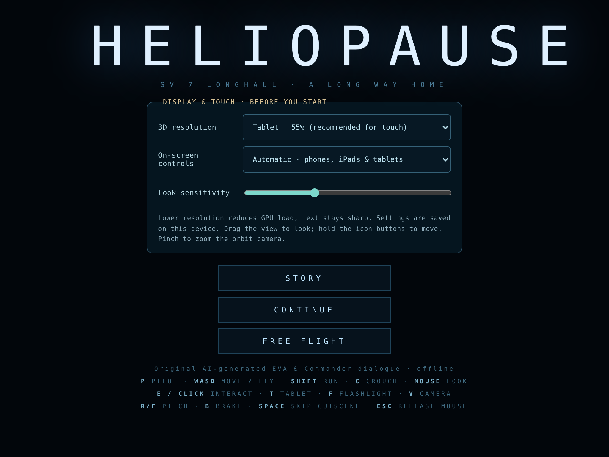
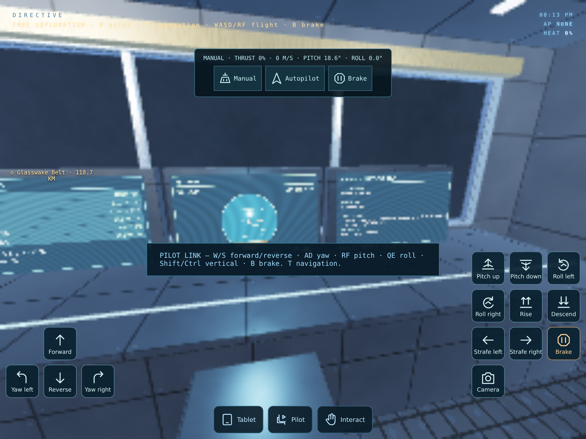
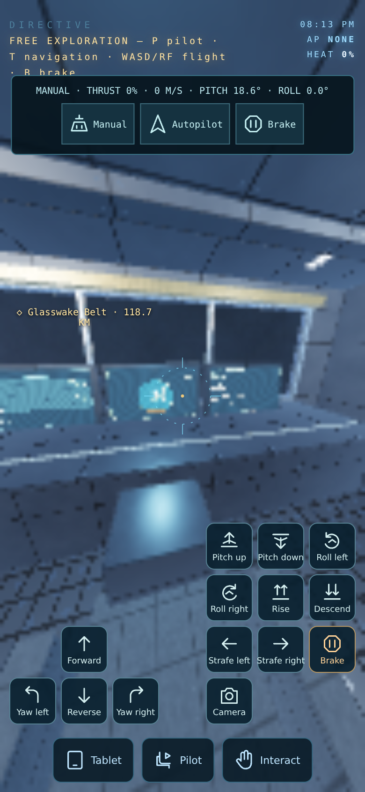

# Mobile priority previews

Actual Chromium touch-emulation screenshots of the mobile-only priority build. SVG controls and text remain at display resolution while the 3D view uses the software GPU's reduced-resolution cap. These are not physical-iPad or Safari benchmarks.

## Settings before Story

## Tablet flight controls

## Phone flight controls

[Controls, performance settings and test scope](../../Docs/MOBILE_CONTROLS.md)
