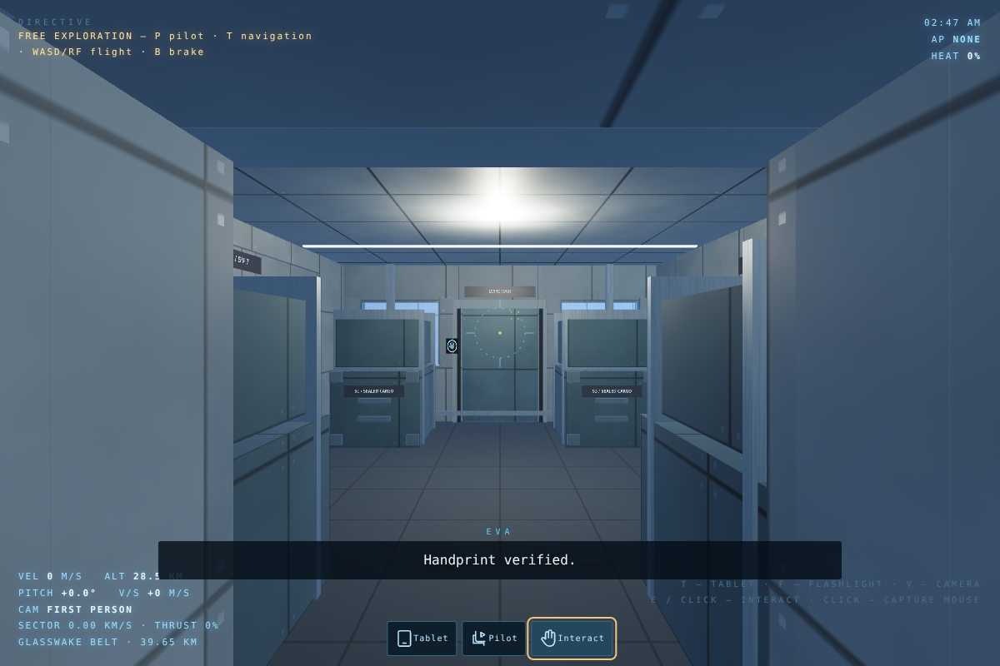
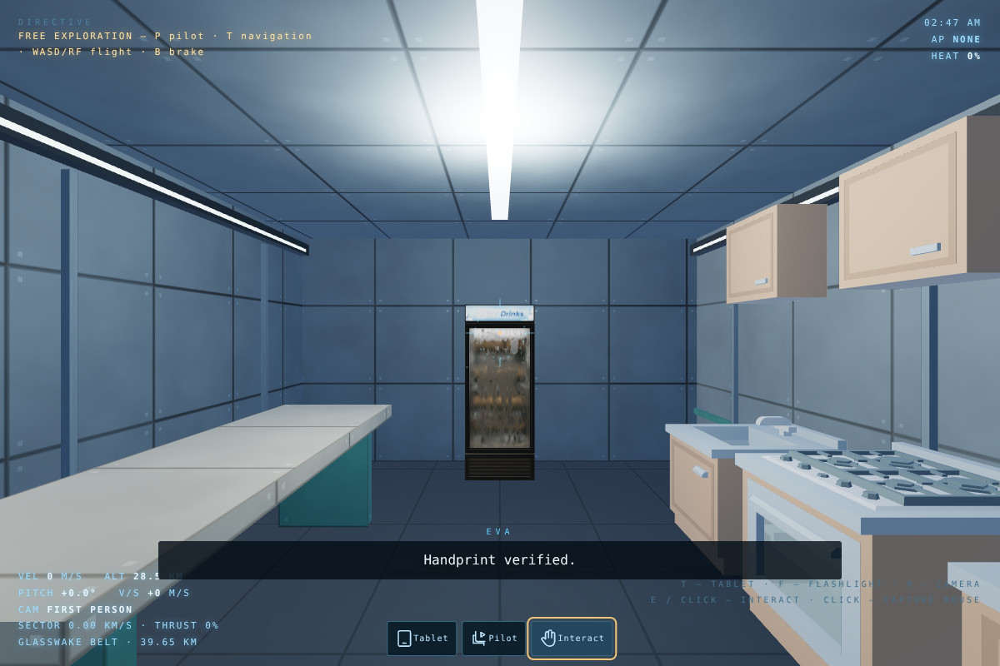

# Sealed room connections — actual game renders

These images are from the browser game at 1200 × 800. The route uses walking and door interactions, not teleporting between rooms. The capture build raises the software-GPU raster cap; it does not add scenery or edit the screenshots. Embedded/offline models are used here, with the software texture-memory limit retained.

## Core-to-room collar

The return view shows the floor, both side walls and overhead closure connecting the galley to storage. The previous open gap is replaced by a continuous enclosure.

## Shared materials and lighting

[Living room](living-entrance.png) · [Bathroom](bathroom-entrance.png) · [Gym](gym-entrance.png) · [Pool](pool-entrance.png) · [Dining](dining-entrance.png)

## Connected annexes

[Workshop return to bathroom](bathroom-annex-return.png) · [Medical return to gym](gym-annex-return.png)

## Each core seal, viewed from inside

[Kitchen](kitchen-collar-return.png) · [Living](living-collar-return.png) · [Bathroom](bathroom-collar-return.png) · [Gym](gym-collar-return.png) · [Pool](pool-collar-return.png) · [Dining](dining-collar-return.png)

[Implementation, routes and test instructions](../../Docs/PRESSURE_SEALS.md) · [18-variant model audit](model-audit.json)

The structural model audit is not a subjective visual-quality score. It does not claim every model has been replaced or that all hardware/Unreal/Safari rendering is verified.
