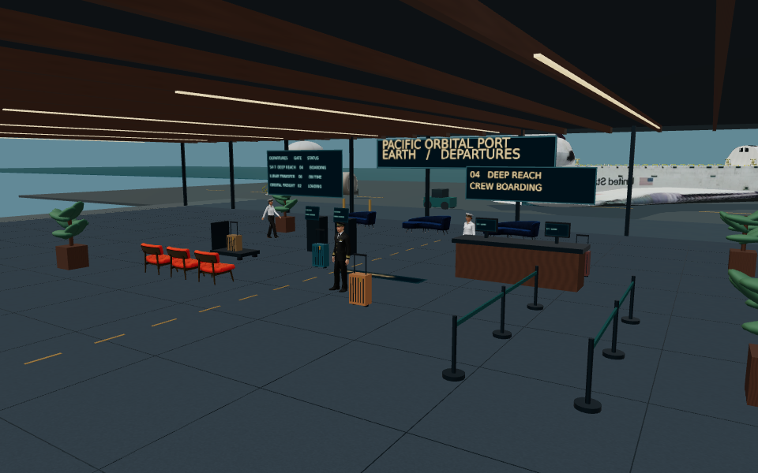
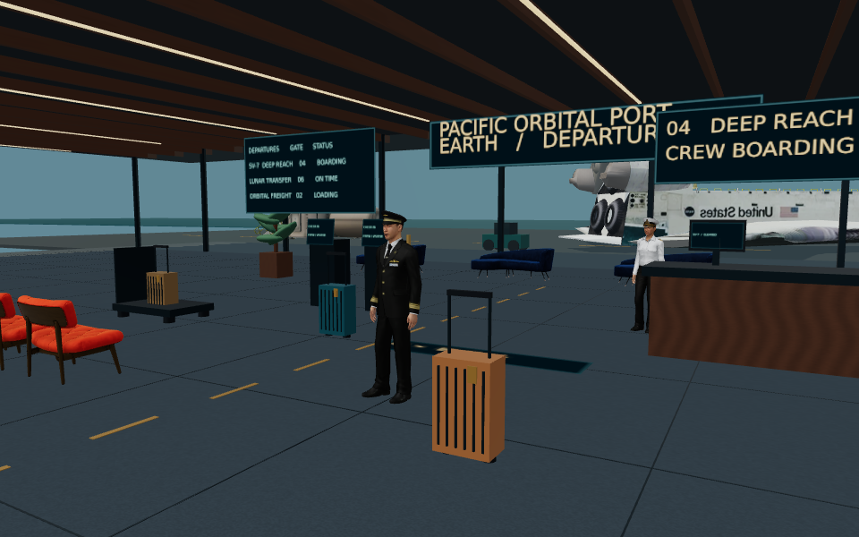
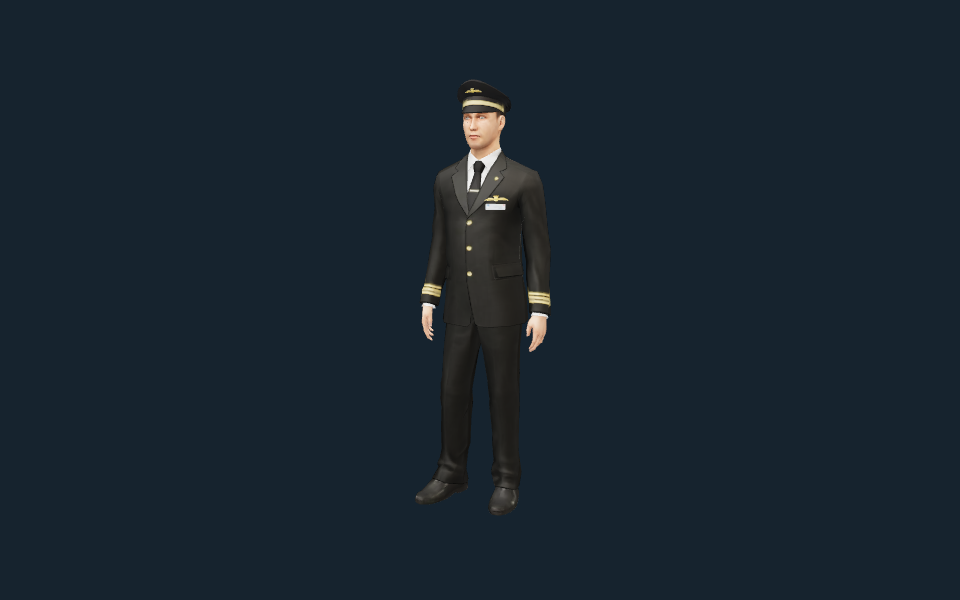
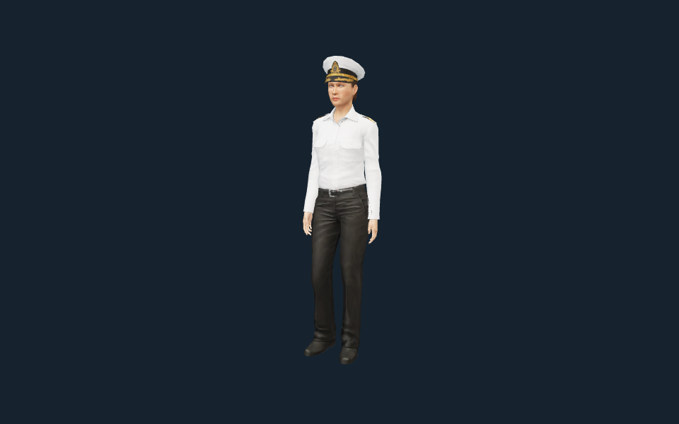
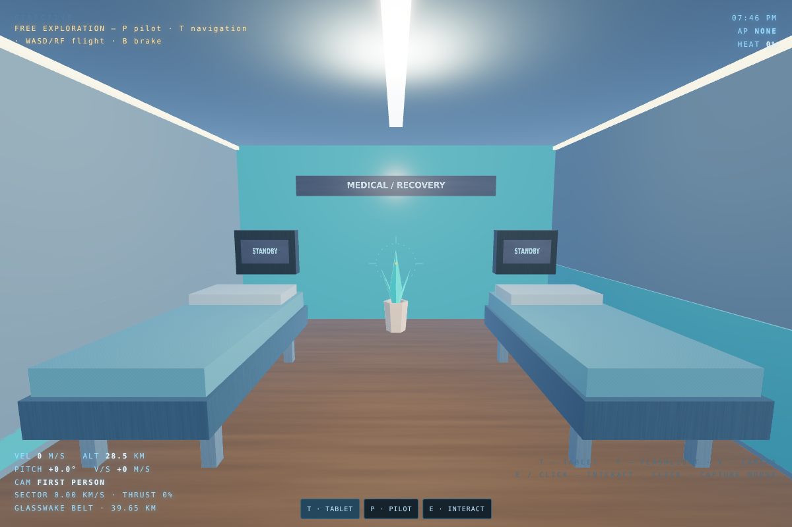
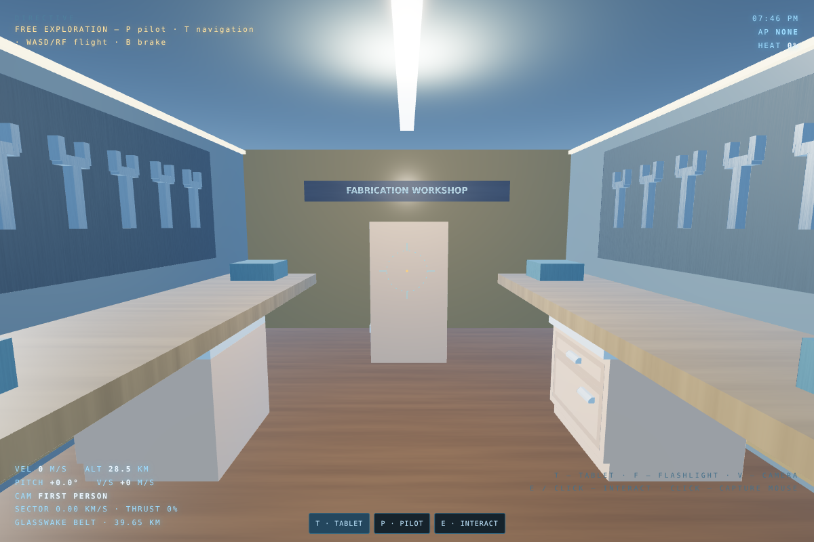
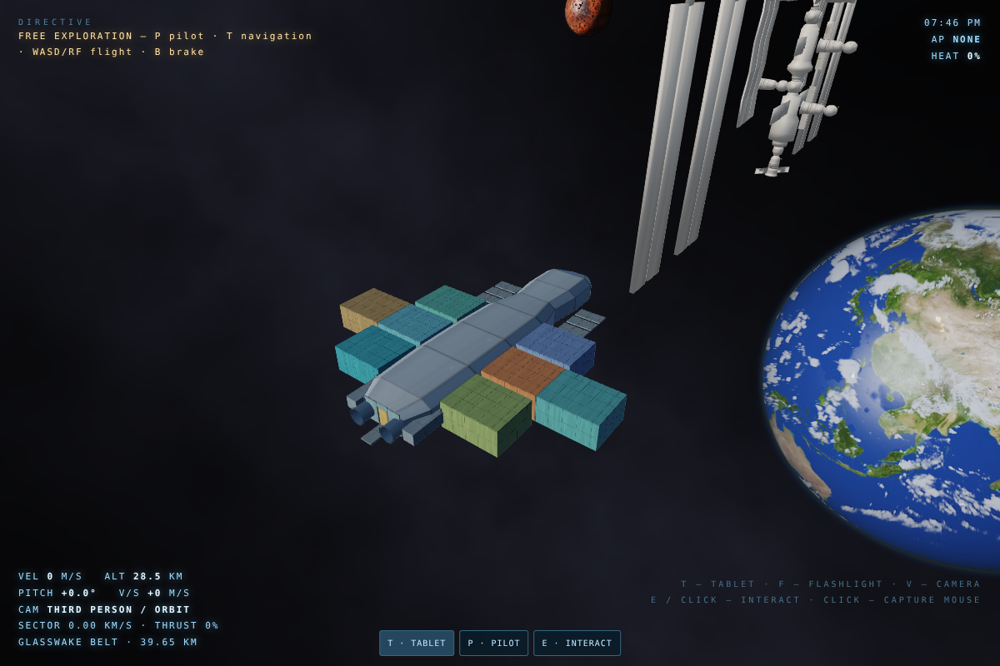

# HELIOPAUSE — rendered previews

Actual browser-renderer output, **not AI concept art**. These previews show the terminal/animation/connected-room upgrade. They do not establish Unreal parity or high-end hardware performance.

## Mobile / iPad priority update

[Pre-story resolution settings and SVG touch-control screenshots](Mobile/README.md) · [Mobile controls guide](../Docs/MOBILE_CONTROLS.md)

## Opening cutscene

[▶ Earth departure — 12-second silent preview](Cutscenes/earth-departure.mp4)

The game retains its complete 27-second opening and dialogue. The video samples the opening at **640 × 400, 12 fps**, on a software GPU; audio is deliberately not captured. Stills below are **960 × 600**.





[Boarding-clearance camera at 22 seconds](Cutscenes/boarding-clearance.png)

## Character assets and motion

| Commander | Officer |
|---|---|
|  |  |
| [Neutral walk clip](Assets/commander-walk.mp4) | [Neutral walk clip](Assets/officer-walk.mp4) |

Walk previews are three-second, in-place inspection clips using the same checked animation controller as the game. The terminal's moving background character also travels at the source stride rate. Limbs are driven by matching Rocketbox clips, not hand-tweaked bone rotations. Mathematical checks and visual samples are evidence—not a guarantee that every possible pose is perfect.

## Rooms — real game renders

**Medical / recovery:** enter through the gym. Two recovery berths, standby displays and a supply-cabinet interaction reporting live ship environmental values.



**Fabrication workshop:** enter through the bathroom. The service bench starts an actual engineering maintenance job if a fault exists and a service swarm is available.



[Kitchen](Rooms/kitchen.png) · [Living room](Rooms/living.png) · [Bathroom](Rooms/bathroom.png) · [Gym](Rooms/gym.png) · [Pool](Rooms/pool.png) · [Dining](Rooms/dining.png)



Room images are **1200 × 800** using the actual game renderer, with private capture fixtures positioning the camera. The capture build only raises the software-GPU raster cap. No player-visible teleport/debug buttons were added. These are inspection views, not evidence of a complete campaign playthrough.

## Other asset previews

[Shuttle](Assets/shuttle.png) · [ISS](Assets/iss.png) · [NASA habitat](Assets/habitat.png) · [NASA habitat interior](Assets/habitat-interior.png) · [Sofa](Assets/sofa.png) · [Chair](Assets/chair.png) · [Refrigerator](Assets/fridge.png)

These use embedded/offline GLBs and a 512-pixel software texture cap. Higher-resolution streamed materials remain available in the game. Asset images show actual upstream geometry/materials; they are not a claim of final photorealistic production quality.

## Reproduce

From the repository root:

```sh
npm ci --prefix BrowserPreview
# Installs the capture encoder only into ignored scratch storage:
python -m pip install --target Artifacts/python imageio-ffmpeg Pillow
npm --prefix BrowserPreview run dev -- --port 5173
# In another terminal, once Vite is ready:
npm --prefix BrowserPreview run capture:previews
npm --prefix BrowserPreview run capture:rooms
```

Do not edit/rebuild the browser source during the Vite capture: hot reload interrupts its timeline. Intermediate video frames and encoder binaries stay under ignored `Artifacts/`; only deliverable images, MP4s and reports are tracked here. For image-only recaptures: `node BrowserPreview/scripts/capture-previews.mjs --stills-only`.

- [Capture report](render-report.json): model readiness, skeletal joint counts and WebGL/page errors.
- [Validation record](validation.md): tests and explicit limitations.
- [Implementation notes](../Docs/TERMINAL_AND_ANNEXES.md): room dependencies, source provenance and Unreal boundary.

## Attribution

- Humans, breathing and neutral-walk animation: **Microsoft Rocketbox**, MIT, © Microsoft. Pinned source revision and hashes in [`../Content/ThirdParty/Streaming/sources.json`](../Content/ThirdParty/Streaming/sources.json).
- Spacecraft, ISS and habitat: **NASA 3D Resources**; NASA media-usage guidelines apply; no endorsement implied.
- Glam Velvet Sofa: **Wayfair / Eric Chadwick**, CC BY 4.0. Sheen Chair: **Wayfair / Eric Chadwick**, CC0.
- Commercial Refrigerator: **Darmstadt Graphics Group / Eric Chadwick / Sean Thomas**, CC BY 4.0; source attribution retained in repository notices.
- Ship furniture: **Kenney**, CC0. Terminal architecture, signage, luggage, tool racks and recovery fixtures: authored for this project.
- Planet maps visible in ship screenshots: source credits in [`../BrowserPreview/THIRD_PARTY_NOTICES.txt`](../BrowserPreview/THIRD_PARTY_NOTICES.txt).

Full licenses and original model credits are retained under `Content/ThirdParty` and the browser notices.
